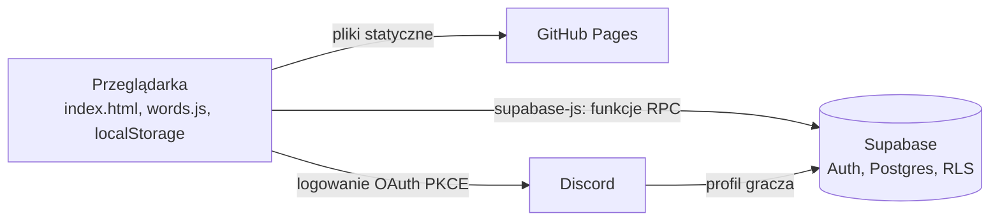

# Słowik

[](https://github.com/Qbzomatique/slowik/actions/workflows/testy.yml)

Polska gra w zgadywanie pięcioliterowego słowa, w stylu Wordle.

**Zagraj:** https://qbzomatique.github.io/slowik/

## Zasady

Masz sześć prób na odgadnięcie słowa. Po każdej próbie płytki zmieniają kolor:

- 🟩 litera jest w słowie i stoi na właściwym miejscu,
- 🟨 litera jest w słowie, ale na innym miejscu,
- ⬛ litery nie ma w słowie.

Polskie znaki to osobne litery: `ą` to nie `a`, a `ł` to nie `l`.

## Funkcje

- **Słowo dnia**: jedno dla wszystkich, zmienia się o północy (#1 = 4 listopada 2026). Próby sprawdza serwer, więc hasła nie ma w przeglądarce.
- **Trening**: losowe słowa bez limitu, działa offline, nie liczy się do statystyk.
- Statystyki, serie i rozkład prób zapisywane w przeglądarce.
- Udostępnianie wyniku jako siatki emoji.
- Tryb trudny i kolory dla daltonistów.
- Sprawdzanie prób w słowniku SJP.PL (28 702 formy pięcioliterowe).
- Opcjonalne logowanie przez Discorda: ranking dnia i ranking ogólny. Bez logowania gra działa w pełni.

## Architektura



Frontend nie ma kroku budowania. W repo jest tylko publiczny klucz publishable, a dane chroni Row Level Security. Wyniki zapisuje wyłącznie funkcja `submit_result`. Analiza, model danych, RODO, znane ograniczenia i wyniki testów RLS: [docs/backend.md](docs/backend.md).

## Struktura

```
index.html              gra (HTML, CSS i JS w jednym pliku)
words.js                pula Treningu i słownik, generowane skryptem
data/answers.txt        alfabetyczna pula słów do Treningu
scripts/build_words.py  buduje words.js ze słownika SJP.PL
scripts/candidates.py   wypisuje kandydatów na nowe hasła dnia
tests/                  testy uruchamiane w GitHub Actions
tests/manual/           ręczne testy RLS z konsoli przeglądarki
supabase/migrations/    schemat bazy, polityki RLS i funkcje RPC
docs/                   analizy: backend.md i ukrycie-hasel.md
```

## Słownik

Próby są sprawdzane w [słowniku do gier SJP.PL](https://sjp.pl/sl/growy/). Plik `slowa.txt` (~45 MB) nie jest w repo. Żeby przebudować `words.js`:

```bash
python scripts/build_words.py ścieżka/do/slowa.txt
```

Kolejność haseł dnia jest tylko w bazie (`private.answers`), wylosowana przy migracji. `data/answers.txt` to alfabetyczna pula do Treningu. Nowe hasła trzeba dodać także migracją na koniec listy w bazie.

Kandydatów na nowe hasła wybiera `scripts/candidates.py`: bierze pięcioliterowe słowa z [listy frekwencyjnej FrequencyWords](https://github.com/hermitdave/FrequencyWords) (polskie napisy filmowe), zostawia te ze słownika SJP.PL i spoza obecnej listy, a potem sortuje je od najczęstszych. Wynik trzeba przejrzeć ręcznie, bo słownik zawiera też formy odmienione.

```bash
python scripts/candidates.py slowa.txt pl_full.txt > kandydaci.txt
```

## Uruchomienie lokalnie

Sama gra działa po otwarciu `index.html` w przeglądarce. Logowanie wymaga adresu z listy przekierowań w Supabase, więc do jego testów uruchom serwer i wejdź na http://localhost:8000/:

```bash
python -m http.server 8000
```

Migracje z `supabase/migrations/` uruchamia się po kolei, według numerów, w SQL Editor Supabase albo przez Supabase CLI.

## Testy

Każdy push na `main` uruchamia testy w GitHub Actions (`.github/workflows/testy.yml`). Wystarczą Python 3.10+ i Node, bez instalowania pakietów. Lokalnie każdy test to jedno polecenie:

```bash
python tests/test_hasla.py         # words.js zgodny z answers.txt; pula posortowana; hasła mają 5 polskich liter, są w słowniku, bez powtórek
node tests/test_score.js           # kolorowanie prób, w tym powtórzone litery i polskie znaki
node tests/test_online.js          # słowo dnia i konto: próby przez serwer, odtwarzanie gry po zalogowaniu (Supabase zamockowany)
node tests/test_skladnia.js        # skrypty z index.html i words.js parsują się bez błędów
```

## Plany

- Bot Discorda z wynikami serwera
- Kolejne gry (polski odpowiednik Krilliona, Connections)

## Licencja

Kod: MIT (zob. `LICENSE`).
Słownik: © SJP.PL, licencja [CC BY 4.0](https://creativecommons.org/licenses/by/4.0/) / GPL 2.
Lista frekwencyjna (wybór haseł dnia): © Hermit Dave, [FrequencyWords](https://github.com/hermitdave/FrequencyWords), licencja [CC BY-SA 4.0](https://creativecommons.org/licenses/by-sa/4.0/).
