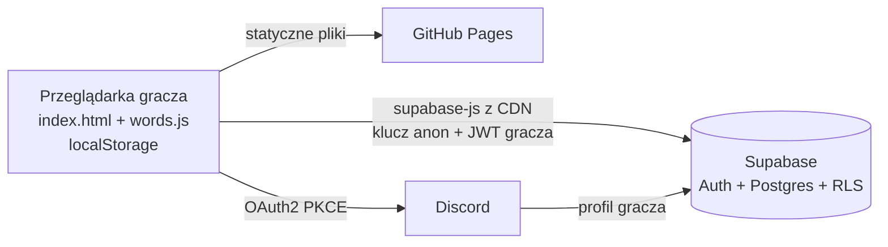
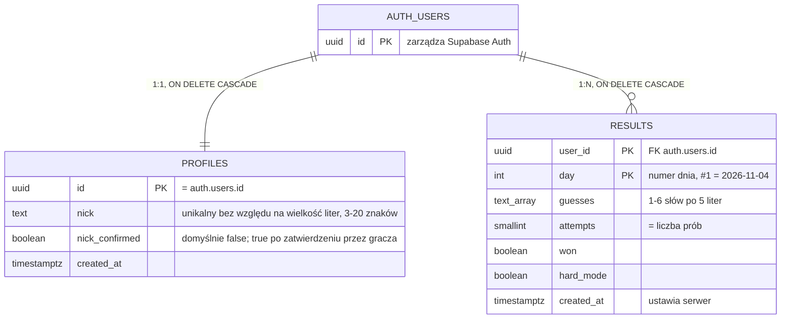

# Słowik: konta, logowanie przez Discorda i rankingi

Dokument analityczny. Wersja 1.3, 9 listopada 2026. Status: **zaakceptowany**.

| Wersja | Data | Zmiany |
|---|---|---|
| 1.0 | 2026-11-04 | Pierwsza wersja |
| 1.1 | 2026-11-04 | Mierniki liczone z bazy; świadome zatwierdzenie nicku (`nick_confirmed`, privacy by design); ograniczenie L9 (wiek graczy); etap ukrycia haseł w planie |
| 1.2 | 2026-11-09 | Wyniki ręcznych testów RLS; klucz publishable zamiast `anon` |
| 1.3 | 2026-11-09 | Ograniczenia L1–L3 rozwiązuje [ukrycie-hasel.md](ukrycie-hasel.md): słowo dnia wymaga sieci, a wynik powstaje z `play_guess` zamiast `submit_result`. Ten dokument opisuje stan sprzed tej zmiany tam, gdzie mówi o grze offline i `submit_result`. |

## 1. Cel

Słowik to dziś statyczna gra: wynik i statystyki zostają w przeglądarce gracza. Docelową grupą są społeczności na Discordzie, które chcą się porównywać, a tego bez wspólnego miejsca na wyniki nie da się zrobić.

Cel tego etapu: **opcjonalne konto przez Discorda, dzięki któremu wynik słowa dnia trafia do wspólnego rankingu**. Gra bez logowania działa dokładnie tak jak dziś.

Mierniki sukcesu (do sprawdzenia po miesiącu). Wszystkie są liczone zapytaniem SQL z bazy, bez analityki w przeglądarce:

- **liczba kont:** wiersze w `profiles`,
- **liczba wyników dziennie:** wiersze w `results` na każdy `day`,
- **retencja 7-dniowa:** odsetek graczy z wynikiem w dniu D, którzy mają też wynik w dniu D+7 (średnio po dniach D, dla których dzień D+7 już minął).

Wymaganie jakościowe: zero zgłoszeń, że gra nie działa przez awarię backendu (gra ma działać offline).

### Zakres

| W zakresie | Poza zakresem (kolejne etapy) |
|---|---|
| Logowanie wyłącznie przez Discorda | Logowanie e-mailem, Google itp. |
| Profil z edytowalnym nickiem | Awatary, opisy profili |
| Zapis wyniku słowa dnia | Zapis treningu (nigdy nie trafia do rankingu) |
| Ranking dnia i ranking ogólny | Rankingi serwerów Discorda, bot, Discord Activity |
| Usunięcie konta ze wszystkimi danymi | Eksport danych do pliku (na razie na prośbę) |
| Podstawowa walidacja wyniku na serwerze | Pełna ochrona przed oszukiwaniem (wymaga ukrycia haseł) |

## 2. Architektura

- **Frontend** zostaje jednym plikiem `index.html` na GitHub Pages, bez kroku budowania. `supabase-js` jest ładowany z CDN w przypiętej dokładnej wersji, najlepiej z atrybutem `integrity` (SRI).
- **Backend** to projekt Supabase w regionie UE (Frankfurt, `eu-central-1`): Auth z dostawcą Discord, Postgres z Row Level Security i funkcje RPC.
- **Sekrety:** w repo są tylko publiczny URL projektu i klucz publishable (następca klucza `anon`, ta sama rola w bazie). Client secret Discorda wpisuje autor w panelu Supabase. Klucz `service_role` nie trafia nigdzie poza panel Supabase.
- **Odporność:** każde wywołanie Supabase jest opakowane w obsługę błędów. Brak sieci lub awaria daje komunikat po polsku, a gra działa dalej na localStorage.

### Kluczowe decyzje

| Decyzja | Wybór | Alternatywy i powód |
|---|---|---|
| Backend | Supabase (darmowy plan) | Firebase: NoSQL i słabsze reguły dla rankingów SQL. Własny serwer: koszt i utrzymanie. Supabase daje Postgres, gotowe OAuth Discorda i RLS. |
| Metoda logowania | Tylko Discord | Docelowa grupa jest na Discordzie. Jedna metoda to mniej kodu, mniej danych i prostsze UI. |
| Zapis wyniku | Wyłącznie funkcja RPC `submit_result` | Bezpośredni INSERT dawałby klientowi kontrolę nad wszystkimi kolumnami (np. `created_at`, który rozstrzyga remisy). Funkcja wymusza walidację w jednym miejscu. |
| Odczyt rankingów | Funkcje `SECURITY DEFINER` zwracające tylko nick i liczby | Publiczny odczyt tabel ujawniałby próby (spoilery) i identyfikatory kont. |
| Przepływ OAuth | PKCE | Zalecany dla aplikacji bez serwera, bo token nie trafia do adresu URL. |

## 3. Interesariusze i role

- **Gracz niezalogowany:** gra jak dotąd, może oglądać rankingi.
- **Gracz zalogowany:** ma konto z nickiem, jego wyniki słowa dnia trafiają do rankingu.
- **Autor (administrator):** zarządza projektem Supabase i aplikacją Discorda, odpowiada za dane (administrator danych w rozumieniu RODO).

## 4. User stories i kryteria akceptacji

### US-1. Gracz niezalogowany

> Jako gracz, który nie chce zakładać konta, chcę grać jak dotąd, żeby logowanie nie było warunkiem zabawy.

- Gra, statystyki „Moje”, udostępnianie i ustawienia działają bez logowania, tak jak przed tą zmianą.
- Strona nie wysyła do Supabase żadnych danych gracza, dopóki gracz się nie zaloguje. Wyjątek: anonimowe pobranie rankingu, gdy gracz sam otworzy zakładkę rankingu.
- Jeśli Supabase lub CDN jest niedostępny, gra działa. Przycisk logowania pokazuje komunikat „Logowanie jest chwilowo niedostępne”.

### US-2. Gracz zalogowany

> Jako gracz z Discorda chcę zalogować się jednym kliknięciem, żeby mój wynik trafiał do rankingu.

- W nagłówku jest przycisk „Zaloguj przez Discord”. Po zalogowaniu na jego miejscu pojawia się nick i menu: zmień nick, wyloguj, usuń konto.
- Przy pierwszym logowaniu powstaje profil z **niezatwierdzonym** nickiem utworzonym z nazwy Discorda. Jeśli nick jest zajęty, system dopisuje do niego liczbę.
- Zaraz po pierwszym logowaniu otwiera się okno „Wybierz nick, będzie widoczny publicznie w rankingu” z tą podpowiedzią w polu do edycji. Gracz zatwierdza nick świadomie, a może go też zmienić. Okno można zamknąć i wrócić do niego z menu konta.
- Dopóki nick nie jest zatwierdzony, wyniki się zapisują, ale gracz **nie pojawia się w rankingach**. Przy nicku w nagłówku widać przypomnienie „zatwierdź nick, żeby trafić do rankingu”.
- Nick można później zmienić: 3–20 znaków, litery (także polskie), cyfry, spacja, `_`, `-`. Wielkość liter nie odróżnia nicków („Ala” i „ala” to ten sam nick). Każda zmiana przez okno nicku oznacza nick jako zatwierdzony.
- Po skończeniu słowa dnia, czyli po wygranej albo sześciu próbach, wynik wysyła się automatycznie. Gracz widzi potwierdzenie albo komunikat o błędzie.
- Jeśli gracz zaloguje się dopiero po dzisiejszej grze, wynik z localStorage wysyła się po zalogowaniu.
- Drugi wynik na ten sam dzień jest odrzucany, a gracz widzi wynik zapisany wcześniej. Gra lokalna nie jest przez to przerywana.
- Wynik treningu nigdy nie jest wysyłany.
- Gdy wysyłka się nie uda (brak sieci), wynik zostaje oznaczony jako niewysłany i wysyła się ponownie przy następnym otwarciu strony, o ile dzień wciąż mieści się w oknie ±1.

### US-3. Gracz sprawdzający ranking

> Jako gracz chcę zobaczyć, jak wypadam na tle innych, dziś i ogólnie.

- Okno statystyk ma trzy zakładki: **Moje** (jak dziś, lokalne), **Ranking dnia**, **Ranking ogólny**.
- **Ranking dnia:** tylko wygrane z danego dnia, posortowane według liczby prób rosnąco, a przy remisie według wcześniejszego zapisu. Kolumny: miejsce, nick, liczba prób, oznaczenie trybu trudnego.
- **Ranking ogólny:** kolumny nick, wygrane, % wygranych, najdłuższa seria, rozegrane gry. Sortowanie: wygrane malejąco, potem % wygranych, potem najdłuższa seria.
- Rankingi pokazują wyłącznie nick i liczby. Nigdy nie pokazują prób (spoiler), identyfikatora konta, danych z Discorda ani adresu e-mail.
- Zalogowany gracz widzi swoje miejsce wyróżnione, także gdy jest poza pierwszą setką.

### US-4. Gracz usuwający konto

> Jako gracz chcę usunąć konto i wszystkie swoje dane, żeby mieć nad nimi kontrolę.

- W menu konta jest „Usuń konto”. Potwierdzenie odbywa się w oknie strony, a nie przez `confirm()`, i wymaga wpisania słowa „usuń”.
- Po potwierdzeniu znikają z bazy: wyniki, profil i konto w Supabase Auth. Nick przestaje być widoczny w rankingach.
- Lokalne statystyki w przeglądarce zostają, bo są niezależne od konta, a okno informuje o tym gracza.
- Ponowne logowanie przez Discorda zakłada nowe, puste konto.

## 5. Wymagania niefunkcjonalne

### 5.1 Prywatność i RODO

Zasada: **minimum danych**. Trzymamy tylko to, co jest potrzebne do rankingu.

| Dane | Gdzie | Po co | Kto widzi |
|---|---|---|---|
| Identyfikator konta (UUID) | `auth.users`, `profiles.id`, `results.user_id` | Powiązanie wyników z kontem | Tylko właściciel i administrator |
| Identyfikator Discorda, nazwa, awatar (URL), **adres e-mail** | `auth.users` i `auth.identities` (zarządza Supabase Auth) | Logowanie. Supabase pobiera e-mail z Discorda obowiązkowo, a gra go nie używa ani nie kopiuje do swoich tabel. | Tylko administrator (panel Supabase) |
| Nick i znacznik zatwierdzenia | `profiles.nick`, `profiles.nick_confirmed` | Wyświetlanie w rankingu | **Publicznie** w rankingach, ale dopiero po zatwierdzeniu przez gracza |
| Wyniki słowa dnia: dzień, próby, liczba prób, wygrana, tryb trudny, czas zapisu | `results` | Ranking i walidacja wyniku | Próby: tylko właściciel. Liczby: publicznie przez rankingi. |
| Adres IP, user agent | Logi Supabase (API i Auth) | Bezpieczeństwo, diagnostyka | Administrator. Retencja na darmowym planie: 1 dzień (logi API/DB), 1 godzina (audyt Auth). |
| Sesja (token) | localStorage przeglądarki, klucz `slowik.auth` | Utrzymanie zalogowania | Tylko przeglądarka gracza |

- **Podstawa prawna:** art. 6 ust. 1 lit. b RODO, czyli świadczenie usługi, o którą gracz prosi, zakładając konto. Publiczny nick w rankingu jest istotą tej usługi, o czym gracz jest informowany przed zalogowaniem.
- **Privacy by design i by default (art. 25 RODO):** pole `global_name` z Discorda to często prawdziwe imię i nazwisko. Dlatego nic nie trafia do publicznego rankingu automatycznie. Nick z Discorda jest tylko podpowiedzią, a domyślne ustawienie to „niewidoczny” (`nick_confirmed = false`). Upublicznienie wymaga świadomego działania gracza w oknie, które mówi wprost, że nick będzie widoczny publicznie.
- **Podmiot przetwarzający:** Supabase Inc. ma umowę powierzenia (DPA) w ramach regulaminu, a dane są w regionie UE. Discord jest odrębnym administratorem danych konta Discord.
- **Prawa gracza:** usunięcie danych przez „Usuń konto”. Sprostowanie przez zmianę nicku. Dostęp: gracz widzi swoje wyniki, a pełną kopię danych wydaje administrator na prośbę (eksport w aplikacji to przyszły krok).
- **Retencja:** dane są przechowywane do usunięcia konta. Polityka usuwania kont nieaktywnych zostanie ustalona przed publicznym ogłoszeniem rankingów.
- **Informacja dla gracza:** krótka nota w oknie „Jak grać” mówi, jakie dane są zapisywane i jak je usunąć. Pełna polityka prywatności będzie osobną stroną przed szerszym ogłoszeniem.
- **Cookies i localStorage:** token sesji jest niezbędny do działania usługi, więc nie wymaga zgody. Gra nie używa analityki ani reklam.

> Ten dokument nie jest opinią prawną. Przed promocją serwisu poza znajomymi warto skonsultować politykę prywatności.

### 5.2 Bezpieczeństwo

- W repo są tylko URL projektu i klucz publishable. Wszystko, co ten klucz umożliwia, jest ograniczone przez RLS i uprawnienia funkcji.
- Klucze secret i `service_role`, client secret Discorda i hasło do bazy nie trafiają do repo ani do rozmów z asystentem.
- RLS jest włączone na każdej tabeli w schemacie `public`. Domyślnie wszystko jest zabronione, a polityki dopuszczają tylko opisane wyżej operacje.
- Funkcje `SECURITY DEFINER` mają ustawione `search_path = ''` i używają w pełni kwalifikowanych nazw obiektów, co zapobiega podmianie obiektów.
- Prawa `EXECUTE` są nadane jawnie: rankingi dla `anon` i `authenticated`, zapis, zmiana nicku i usunięcie konta tylko dla `authenticated`.
- Biblioteka z CDN ma przypiętą dokładną wersję i hash SRI.
- Do adresów przekierowania OAuth w Supabase należą tylko `https://qbzomatique.github.io/slowik/` i lokalny adres testowy.

### 5.3 Dostępność, wydajność i odporność

- Gra nie czeka na Supabase: biblioteka ładuje się asynchronicznie i po pierwszym wyświetleniu planszy.
- Rankingi ładują się dopiero po otwarciu zakładki. Ranking ogólny zwraca najwyżej 100 pozycji plus pozycję gracza.
- Każde wywołanie sieciowe ma limit czasu (np. 8 s) i komunikat po polsku.
- Interfejs logowania i rankingów działa na telefonie (~390 px) i w trybie ciemnym oraz spełnia te same zasady co reszta gry: zmienne CSS, obsługa klawiatury i Escape w oknach.

### 5.4 Testowalność

- Logika klienta (budowanie wyniku do wysłania, synchronizacja z localStorage, kolejka niewysłanych wyników) jest wydzielona tak, żeby dało się ją testować w Node z zamockowanym Supabase.
- Testy w CI nie wymagają dostępu do Supabase.
- Polityki RLS są sprawdzane ręcznie według listy kontrolnej z rozdziału 9.

## 6. Model danych

- `results` ma klucz główny `(user_id, day)`, co oznacza jeden wynik na dzień.
- Ograniczenia `CHECK`: `attempts` między 1 a 6 i równe `cardinality(guesses)`. Każda próba pasuje do `^[a-ząćęłńóśźż]{5}$`. Przegrana oznacza dokładnie 6 prób.
- Profil tworzy trigger po założeniu konta w `auth.users`. Nick bierze z `global_name` lub `full_name` z danych Discorda, oczyszcza go z niedozwolonych znaków i przy kolizji dopisuje numer. Gdy po oczyszczeniu zostaje mniej niż 3 znaki, nick to `gracz` z numerem. Profil zawsze startuje z `nick_confirmed = false`.
- Gracz z `nick_confirmed = false` nie występuje w żadnym rankingu, ale jego wyniki są zapisywane. Po zatwierdzeniu nicku pojawia się w rankingach, także z wcześniejszymi wynikami.
- Szacunek rozmiaru: wiersz `results` ma około 150 B. Przy 1000 graczy dziennie przez rok to około 55 MB, mieści się w limicie 500 MB.

### Funkcje (RPC)

| Funkcja | Kto | Co robi |
|---|---|---|
| `submit_result(day, guesses, won, hard_mode)` | `authenticated` | Waliduje i zapisuje wynik bieżącego użytkownika. Zwraca zapisany wiersz albo istniejący, gdy wynik na ten dzień już jest. |
| `ranking_day(day)` | `anon`, `authenticated` | Ranking jednego dnia: miejsce, nick, próby, tryb trudny. Tylko gracze z `nick_confirmed = true`. |
| `ranking_overall(limit)` | `anon`, `authenticated` | Ranking ogólny: nick, gry, wygrane, % wygranych, najdłuższa seria. Tylko gracze z `nick_confirmed = true`. |
| `set_nick(nick)` | `authenticated` | Ustawia i zatwierdza własny nick (`nick_confirmed = true`). Waliduje go i zwraca czytelny błąd, gdy nick jest zajęty. |
| `delete_my_account()` | `authenticated` | Usuwa wiersz w `auth.users` bieżącego użytkownika. Kaskada usuwa profil i wyniki. |

Walidacja w `submit_result`:

1. Użytkownik jest zalogowany (`auth.uid()` nie jest pusty).
2. `day` mieści się w przedziale dzisiejszy numer dnia ±1. Dzień liczony jest w UTC, bo gracze z różnych stref mogą być dzień do przodu lub do tyłu.
3. Liczba prób to 1–6, każda ma 5 liter z polskiego alfabetu, a przegrana oznacza 6 prób.
4. Wynik na ten dzień jeszcze nie istnieje. Gdy istnieje, nic nie jest nadpisywane.
5. `created_at` ustawia serwer.

**Najdłuższa seria** to najdłuższy ciąg kolejnych numerów dni z wygraną, liczony metodą „luk i wysp” (`day - row_number()`).

## 7. Zasady RLS

Domyślnie (RLS włączone, brak polityk) klient nie może niczego. Dopuszczamy tylko:

| Tabela | Operacja | Kto | Warunek | Uzasadnienie |
|---|---|---|---|---|
| `profiles` | SELECT | `authenticated` | `id = auth.uid()` | Gracz widzi swój profil. Cudze nicki są widoczne tylko przez funkcje rankingów. |
| `profiles` | UPDATE | brak | — | Zmiana i zatwierdzenie nicku tylko przez `set_nick` (walidacja, czytelny błąd przy zajętym nicku). Klient nie może sam ustawić `nick_confirmed`. |
| `profiles` | INSERT, DELETE | brak | — | Profil tworzy trigger, a usuwa kaskada z `delete_my_account`. |
| `results` | SELECT | `authenticated` | `user_id = auth.uid()` | Gracz widzi swoje wyniki i próby. Cudzych prób nie widzi nikt. |
| `results` | INSERT, UPDATE, DELETE | brak | — | Zapis tylko przez `submit_result`. Wyniku nie da się zmienić ani usunąć pojedynczo. |

Funkcje `SECURITY DEFINER` działają z prawami właściciela i omijają RLS, dlatego każda sama sprawdza `auth.uid()` i zwraca tylko dozwolone kolumny.

## 8. Znane ograniczenia i ryzyka

| # | Ograniczenie lub ryzyko | Skutek | Co robimy teraz | Przyszły krok |
|---|---|---|---|---|
| L1 | **Hasła są publiczne w `words.js`** | Każdy może podejrzeć słowo dnia i wysłać „wygraną w 1 próbie”. Serwer nie zna hasła, więc nie zweryfikuje wygranej. | Walidacja formatu i okna dni. Ograniczenie jest opisane w dokumentacji. | Ukrycie haseł: tabela haseł w bazie i sprawdzanie prób przez RPC. |
| L2 | Serwer nie sprawdza, czy próby są w słowniku | Można wysłać dowolne 5 liter. | Akceptujemy, bo gra też ma tryb bez słownika. | Razem z L1. |
| L3 | Serwer nie weryfikuje trybu trudnego | Flaga `hard_mode` jest deklaracją gracza. | Oznaczenie w rankingu jest informacyjne, nie zmienia kolejności. | Razem z L1. |
| L4 | Okno ±1 dzień | Wynik można wysłać do doby po końcu dnia. | Wynik i tak tylko raz. | — |
| L5 | Darmowy projekt jest **pauzowany po 7 dniach bez aktywności** | Logowanie i ranking przestają działać (gra działa). | Komunikat w grze. | Cotygodniowe zapytanie z GitHub Actions podtrzymujące projekt. |
| L6 | Brak automatycznych kopii zapasowych na darmowym planie | Utrata rankingów przy awarii lub błędzie. | Akceptujemy na etapie testów. | Okresowy zrzut `pg_dump` lub plan płatny. |
| L7 | Brak limitu liczby wywołań RPC | Ktoś może masowo wywoływać rankingi. | Funkcje są lekkie, wyniki ograniczone do 100 wierszy. | Cache lub limity w Edge Function. |
| L8 | Supabase przechowuje e-mail z Discorda | Więcej danych niż potrzeba. | Nie kopiujemy go ani nie używamy, a polityka prywatności o nim mówi. | Sprawdzić, czy da się zawęzić zakresy OAuth. |
| L9 | **Gracze poniżej 16 lat.** Discord dopuszcza konta od 13 lat, a w Polsce zgodę na usługi online może samodzielnie wyrazić osoba od 16 lat (art. 8 RODO). | Część graczy może być niepełnoletnia. Przetwarzanie opiera się na usłudze (lit. b), nie na zgodzie, ale wymaga to potwierdzenia. | Minimum danych, nick niewidoczny bez świadomego zatwierdzenia, łatwe usunięcie konta. | Wyjaśnić przy pełnej polityce prywatności, **przed szerszym ogłoszeniem**. |

## 9. Lista kontrolna ręcznych testów RLS

Przebieg 9 listopada 2026, na produkcyjnym projekcie. R1–R4: zapytania do API bez logowania. R5–R13, R15, R16: skrypt `tests/manual/rls_console.js` w konsoli przeglądarki jako gracz A. R14, R17–R20: interfejs gry na dwóch kontach Discord. W kolumnie „Wynik” przy odmowie podany jest kod błędu Postgresa.

| # | Scenariusz | Oczekiwany wynik | Wynik |
|---|---|---|---|
| R1 | Niezalogowany: `insert` do `results` | Błąd uprawnień | ✅ 42501 |
| R2 | Niezalogowany: `submit_result` | Błąd: brak logowania | ✅ 42501 |
| R3 | Niezalogowany: `select` z `results` i `profiles` | Odmowa dostępu | ✅ 42501 |
| R4 | Niezalogowany: `ranking_day`, `ranking_overall` | Działa, tylko nick i liczby | ✅ |
| R5 | A: bezpośredni `insert` do `results` (nawet z własnym `user_id`) | Błąd uprawnień | ✅ |
| R6 | A: `submit_result` na dziś | Zapisane | ✅ |
| R7 | A: drugi `submit_result` na dziś z innymi próbami | Zwraca pierwszy wynik, nic nie nadpisane | ✅ |
| R8 | A: `submit_result` na dzień dzisiejszy +2 i −2 | Błąd: dzień poza oknem | ✅ |
| R9 | A: 7 prób, 0 prób, próba 4-literowa, próba z cyfrą, przegrana z 3 próbami | Błąd walidacji | ✅ |
| R10 | A: `update` i `delete` na swoim wierszu `results` | Błąd uprawnień lub 0 zmienionych wierszy | ✅ |
| R11 | A: `select` z `results` | Tylko własne wiersze | ✅ powtórzone na dwóch kontach |
| R12 | A: `select` z `profiles` | Tylko własny profil | ✅ powtórzone na dwóch kontach |
| R13 | A: bezpośredni `update` `profiles` (nick lub id) | Błąd uprawnień lub 0 wierszy | ✅ |
| R14 | A: `set_nick` na nick zajęty przez B (inna wielkość liter) | Błąd: nick zajęty | ✅ |
| R15 | A: `set_nick` z niedozwolonymi znakami lub złej długości | Błąd walidacji | ✅ |
| R16 | Rankingi nie zawierają `user_id`, prób, e-maila ani danych Discorda | Potwierdzone | ✅ |
| R17 | A: `delete_my_account` | Konto, profil i wyniki A znikają, B bez zmian | ✅ |
| R18 | Po R17 stary token A: `submit_result` | Błąd | ✅ 23503 |
| R19 | Nowy gracz C bez zatwierdzonego nicku: `submit_result`, potem `ranking_day` i `ranking_overall` | Wynik C zapisany, ale C nie występuje w żadnym rankingu | ✅ |
| R20 | C: `set_nick`, potem rankingi | C pojawia się w rankingach razem z wcześniejszym wynikiem | ✅ |

## 10. Limity darmowego planu Supabase

Stan na 4 listopada 2026 według [cennika Supabase](https://supabase.com/pricing):

| Zasób | Limit (Free) | Ocena dla Słowika |
|---|---|---|
| Aktywne projekty | 2 | Wystarczy (1 projekt) |
| Baza danych | 500 MB na projekt, wspólny CPU, 500 MB RAM | Około 55 MB na rok przy 1000 graczy dziennie |
| Transfer (egress) | 5 GB (plus 5 GB z cache) | Ranking ma kilka KB. Wystarczy na dziesiątki tysięcy odsłon dziennie. |
| Aktywni użytkownicy (MAU) | 50 000, w tym logujący się przez zewnętrznych dostawców | Z dużym zapasem |
| Pliki (Storage) | 1 GB | Nie używamy |
| Edge Functions | 500 000 wywołań na miesiąc | Nie używamy na tym etapie |
| Realtime | 200 jednoczesnych połączeń | Nie używamy na tym etapie |
| Pauzowanie | Po 7 dniach bez aktywności | Ryzyko L5 |
| Kopie zapasowe | Brak automatycznych | Ryzyko L6 |
| Logi | API i bazy danych: 1 dzień, audyt Auth: 1 godzina | Mała retencja, co jest korzystne dla prywatności |
| Zapytania API | Bez limitu | Ryzyko L7 |

## 11. Plan wdrożenia

| Krok | Zawartość | Kto |
|---|---|---|
| 0 | Ten dokument i jego akceptacja | Autor + asystent |
| 1 | Projekt Supabase (UE), aplikacja Discorda, adresy przekierowania | Autor (instrukcja od asystenta) |
| 2 | Migracje SQL w `supabase/migrations/`, przegląd, wklejenie do bazy, testy RLS z rozdziału 9 | Asystent pisze, autor akceptuje i uruchamia |
| 3 | Frontend: logowanie, menu konta, wysyłka wyniku, zakładki rankingów, nota o danych | Asystent |
| 4 | Testy klienta z mockiem Supabase, README (architektura), CLAUDE.md, wyniki testów RLS w tym dokumencie | Asystent |
| Etap następny | Przed publicznym ogłoszeniem rankingów: ukrycie haseł (L1–L3) | Do zaplanowania |

Po każdym kroku jest commit na `main`, a testy CI pozostają zielone.
