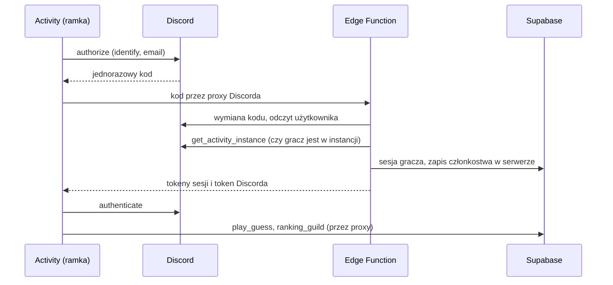

# Słowik: gra w Discordzie (Activity) i ranking serwera

Dokument analityczny. Wersja 1.1, 9 listopada 2026. Status: **zaakceptowany**. Kontynuacja [backend.md](backend.md) i [ukrycie-hasel.md](ukrycie-hasel.md).

## 1. Cel

Docelowi gracze są na Discordzie, a dziś muszą przejść na osobną stronę i nie widzą, jak idzie znajomym. Cel: **uruchomić słowo dnia bezpośrednio w kanale i pokazać, kto z serwera już zagrał i z jakim wynikiem**.

Mierniki (liczone z bazy):

- liczba serwerów z co najmniej jednym graczem tygodniowo,
- odsetek wyników dnia pochodzących z Activity,
- średnia liczba graczy na serwer dziennie,
- retencja 7-dniowa graczy Activity w porównaniu ze stroną.

### Zakres

| W zakresie | Poza zakresem |
|---|---|
| Activity z tą samą grą i tym samym kontem co na stronie | Rozgrywka na żywo między graczami |
| Ranking serwera na dziś: nick, liczba prób | Ujawnianie cudzych prób |
| Lista osób obecnych w Activity | Płatności i funkcje premium |
| Weryfikacja aplikacji, polityka prywatności, regulamin | Kolejne gry |
| Bot z dziennym postem (ostatni etap, opcjonalny) | Moderacja i komendy administracyjne |

## 2. Warianty

| Wariant | Co dostaje gracz | Koszt | Ocena |
|---|---|---|---|
| A. Sam bot z linkiem do strony | Komenda i post z wynikami, gra poza Discordem | Mały | Nie spełnia „odpalania z czatu” |
| **B. Activity z rankingiem serwera (rekomendacja)** | Gra w kanale i podgląd wyników serwera | Duży | Spełnia cel |
| C. Activity bez konta | Gra w kanale, bez rankingu | Średni | Brak podglądu znajomych |

Bot może dojść do wariantu B później, bo korzysta z tych samych danych.

## 3. Jak działają Activities (ustalenia z dokumentacji)

- Activity to strona w ramce, działająca w Discordzie na komputerze, telefonie i w przeglądarce. Można ją uruchomić w kanałach, w DM i z App Launchera ([How Activities Work](https://docs.discord.com/developers/activities/how-activities-work), [Activities](https://docs.discord.com/developers/platform/activities)).
- Działa pod adresem `https://<client_id>.discordsays.com`. CSP ogranicza zapytania do proxy aplikacji, a każdy inny adres trzeba zmapować w panelu ([Networking](https://docs.discord.com/developers/activities/development-guides/networking)).
- Osoby w tym samym kanale dzielą jedną instancję. SDK podaje `instanceId`, `guildId` i listę uczestników ([Multiplayer](https://docs.discord.com/developers/activities/development-guides/multiplayer-experience)).
- **Danym od klienta nie wolno ufać.** Podstawiony klient może udawać Discorda, więc serwer ma sprawdzić instancję przez `get_activity_instance` z tokenem bota.
- Logowanie: `authorize` daje kod, serwer wymienia go z użyciem sekretu, klient przekazuje token do `authenticate` ([Building an Activity](https://docs.discord.com/developers/activities/building-an-activity)).
- **Ograniczenia przed weryfikacją:** niezweryfikowana Activity działa na serwerach poniżej 25 osób i widzą ją tylko twórcy i testerzy. Po weryfikacji jest widoczna dla wszystkich ([Verified and Unverified Activities](https://support-dev.discord.com/hc/en-us/articles/26576097154199-What-are-Verified-and-Unverified-Activities)). Weryfikacja obejmuje potwierdzenie tożsamości właściciela przez Stripe ([How Do I Get My App Verified](https://support-dev.discord.com/hc/en-us/articles/23926564536471-How-Do-I-Get-My-App-Verified)). Oba artykuły są starsze, więc aktualne warunki trzeba sprawdzić w panelu.

## 4. Rozwiązanie

### 4.1 Frontend

- **Jeden `index.html` dla strony i Activity.** Tryb rozpoznawany po parametrach Discorda w adresie. Bez kroku budowania.
- Mapowania w panelu: `/` na GitHub Pages i `/supabase` na projekt Supabase. Klient Supabase w Activity używa adresu zmapowanego.
- `supabase-js` i SDK Discorda jako pliki w `vendor/`, bo CDN jest blokowany. Czcionki Google: mapowanie albo czcionki systemowe w Activity.
- W Activity gracz jest zawsze zalogowany, bo konto daje Discord. Pozostaje zgoda na ekranie Discorda i świadome zatwierdzenie nicku.
- Nowy widok „Ten serwer”: kto dziś zagrał i z jakim wynikiem, odświeżany co 20 s. Bez Realtime, żeby nie zwiększać ryzyka z CSP.
- Układ musi działać w małej ramce i na telefonie.

### 4.2 Logowanie (największe ryzyko)

Przekierowanie OAuth z obecnej strony nie zadziała w ramce. Edge Function `activity-auth` musi wydać sesję Supabase temu samemu kontu, którego gracz używa na stronie.

| Sposób | Opis | Ocena |
|---|---|---|
| **1. `admin.generateLink` + `verifyOtp` (pierwszy do sprawdzenia)** | Funkcja generuje jednorazowy skrót dla e-maila z Discorda i wymienia go na sesję; nic nie jest wysyłane. Odpowiada to wzorcowi z dokumentacji Supabase. | Nie wiadomo, czy działa przy **wyłączonym dostawcy Email**. Może wymagać ponownego włączenia. |
| 2. Własny podpisany JWT | Funkcja podpisuje token kluczem projektu | Więcej odpowiedzialności za bezpieczeństwo i rotację kluczy |
| 3. Funkcja jako pośrednik wszystkich wywołań | Brak sesji w ramce | Dużo kodu i klucz `service_role` przy każdym zapytaniu |

Wymagania dla każdego sposobu:

- Funkcja szuka konta po potwierdzonym e-mailu z Discorda i odrzuca sesję, gdy konto jest powiązane z innym identyfikatorem Discord.
- Konto wskazuje **identyfikator Discord**, a nie sam e-mail, gdy gracz ma już konto. Gdy to nowy gracz, konto ma się później połączyć z logowaniem na stronie. Prototyp musi to potwierdzić.
- Konto Discord bez potwierdzonego e-maila: gra działa bez rankingu lub logowanie jest odrzucane, zależnie od wyniku prototypu.
- Sekret Discorda i token bota tylko w Supabase Secrets. Autor wpisuje je w panelu. Nigdy w repo ani w czacie.

### 4.3 Dane i ranking serwera

Nowa tabela `guild_players (guild_id, user_id, last_seen)`, wpis tylko z Edge Function, po sprawdzeniu instancji przez Discorda.

| Funkcja | Kto | Co robi |
|---|---|---|
| `ranking_guild(guild_id, day)` | `authenticated`, tylko członek danego serwera według `guild_players` | Nick, liczba prób, czy wygrana. Tylko `nick_confirmed = true`. |

RLS jak dotąd: `guild_players` bez zapisu z klienta, odczyt tylko własnych wierszy. Usunięcie konta kasuje wpisy kaskadą.

**Prywatność:** gracz pojawia się w rankingu danego serwera dopiero po uruchomieniu tam Activity. Nie czytamy listy członków serwera, wiadomości ani zakresu `guilds`. Identyfikator serwera trafia do nowej pozycji w spisie danych w `backend.md`. Cudzych prób nie pokazujemy.

## 5. Wymagania niefunkcjonalne

- **Bezpieczeństwo:** weryfikacja kodu i instancji po stronie serwera; `service_role` wyłącznie w Edge Function.
- **Limity darmowego planu:** 500 000 wywołań Edge Functions miesięcznie. Funkcja działa tylko przy starcie Activity, więc zapas jest duży. Odświeżanie rankingu to zwykłe RPC.
- **Odporność:** błąd Discorda lub Supabase kończy się komunikatem po polsku, a strona internetowa działa niezależnie.
- **Prawo:** polityka prywatności i regulamin są potrzebne do weryfikacji, a L9 (osoby poniżej 16 lat) staje się pilne.

## 6. Znane ograniczenia i ryzyka

| # | Ograniczenie lub ryzyko | Co robimy |
|---|---|---|
| L14 | Logowanie w ramce może wymagać włączenia dostawcy Email | Rozstrzyga prototyp; jeśli trzeba, włączamy i blokujemy zakładanie kont e-mailem |
| L15 | Weryfikacja wymaga potwierdzenia tożsamości właściciela, a przed nią Activity jest ograniczona | Decyzja autora przed publicznym udostępnieniem |
| L16 | Pamięć przeglądarki w ramce może być ulotna, szczególnie na telefonie | Stan gry bierzemy z serwera przez `get_game` |
| L17 | Ranking serwera pokazuje tylko tych, którzy otworzyli Activity | Celowe: to świadomy udział |
| L18 | Zmiany w Discordzie (SDK, proxy) mogą wymagać poprawek | Wersje przypięte w `vendor/`, testy ręczne po aktualizacji |
| L19 | L10 i L11 nadal obowiązują. Ranking nie daje nagród, więc multikonta i celowe oszustwo mają niski priorytet i nie blokują dodania kolejnych metod logowania, np. Google. | Akceptujemy |

## 7. Lista testów ręcznych (D)

| # | Scenariusz | Wynik |
|---|---|---|
| D1 | Activity uruchamia się w kanale tekstowym, głosowym i w DM, na komputerze i telefonie | — |
| D2 | Konto z Activity jest tym samym kontem co na stronie (ta sama gra i ranking) | — |
| D3 | Nowy gracz z Activity loguje się później na stronie i ma jedno konto | — |
| D4 | Niezatwierdzony nick nie występuje w rankingu serwera | — |
| D5 | Podstawiony `guild_id` lub `instance_id` nie daje wpisu do `guild_players` | — |
| D6 | Gracz spoza serwera nie odczyta `ranking_guild` | — |
| D7 | Ranking serwera nie ujawnia prób, identyfikatorów ani danych Discorda | — |
| D8 | Usunięcie konta kasuje wpisy serwerów | — |
| D9 | Brak sieci w Activity daje komunikat po polsku | — |

## 8. Plan

| Krok | Zawartość | Kto |
|---|---|---|
| 0 | Akceptacja tego dokumentu | Autor |
| 1 | **Prototyp:** Activity na testowym serwerze, sama gra, potem logowanie (L14, D1–D3). Przy negatywnym wyniku wracamy do tabeli z 4.2. | Autor konfiguruje panel, asystent pisze kod |
| 2 | Tabela i funkcje serwera, Edge Function z kontrolą instancji; migracje do akceptacji | Asystent, autor uruchamia |
| 3 | Widok „Ten serwer”, układ w ramce, testy z atrapą SDK | Asystent |
| 4 | Testy D z kilkoma osobami na testowym serwerze | Razem |
| 5 | Polityka prywatności, regulamin (L9), weryfikacja aplikacji (L15) | Autor z pomocą asystenta |
| 6 | Opcjonalnie bot z dziennym postem | Do zaplanowania |
